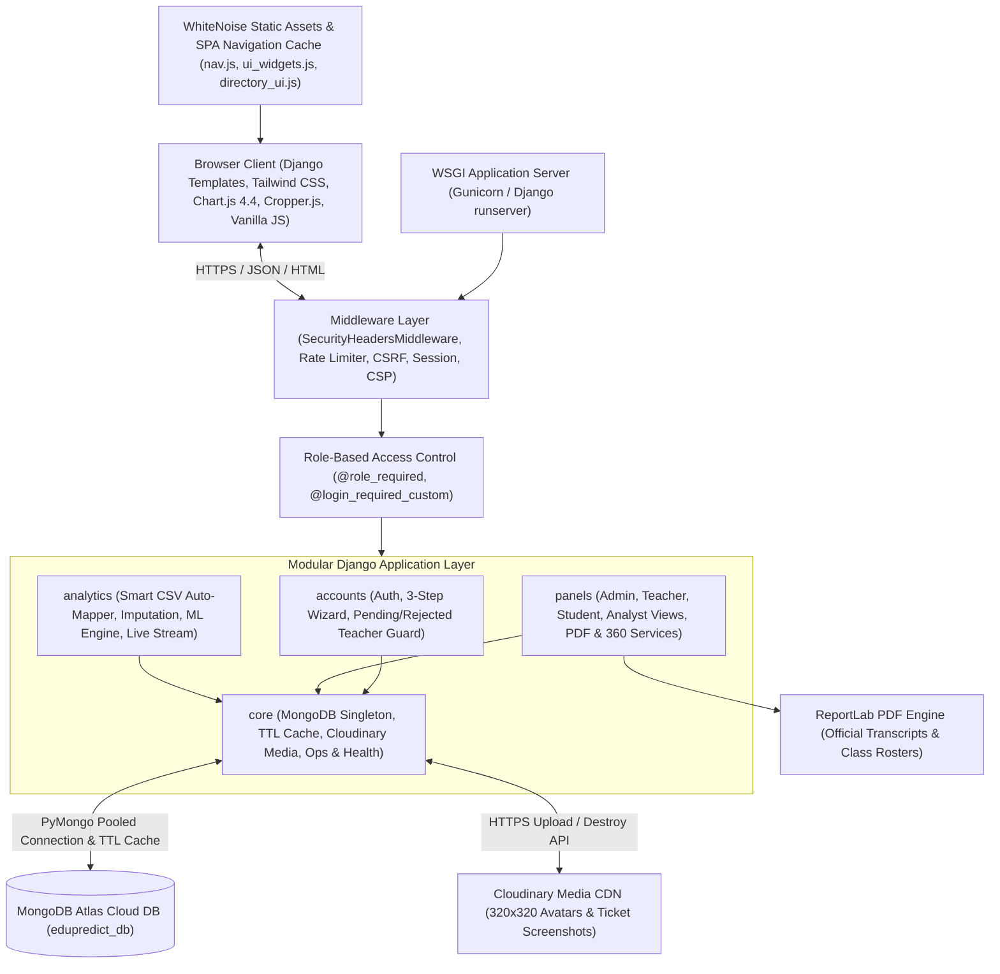
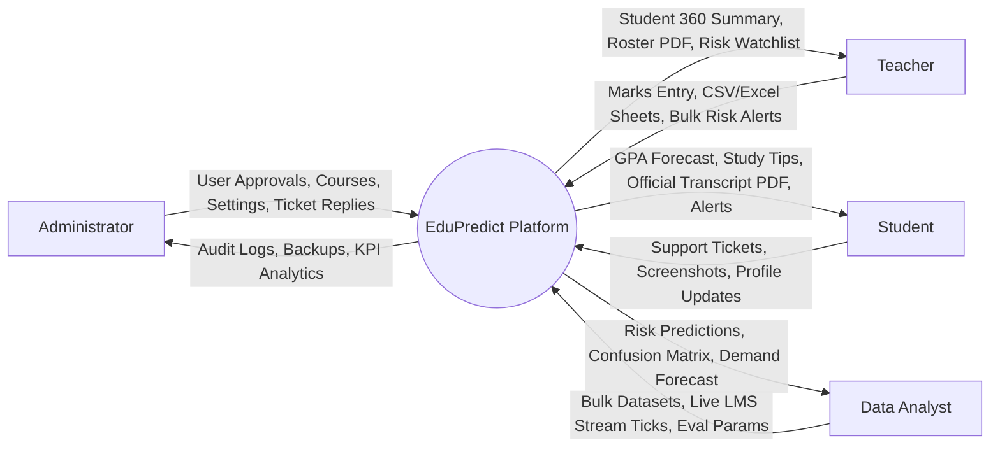
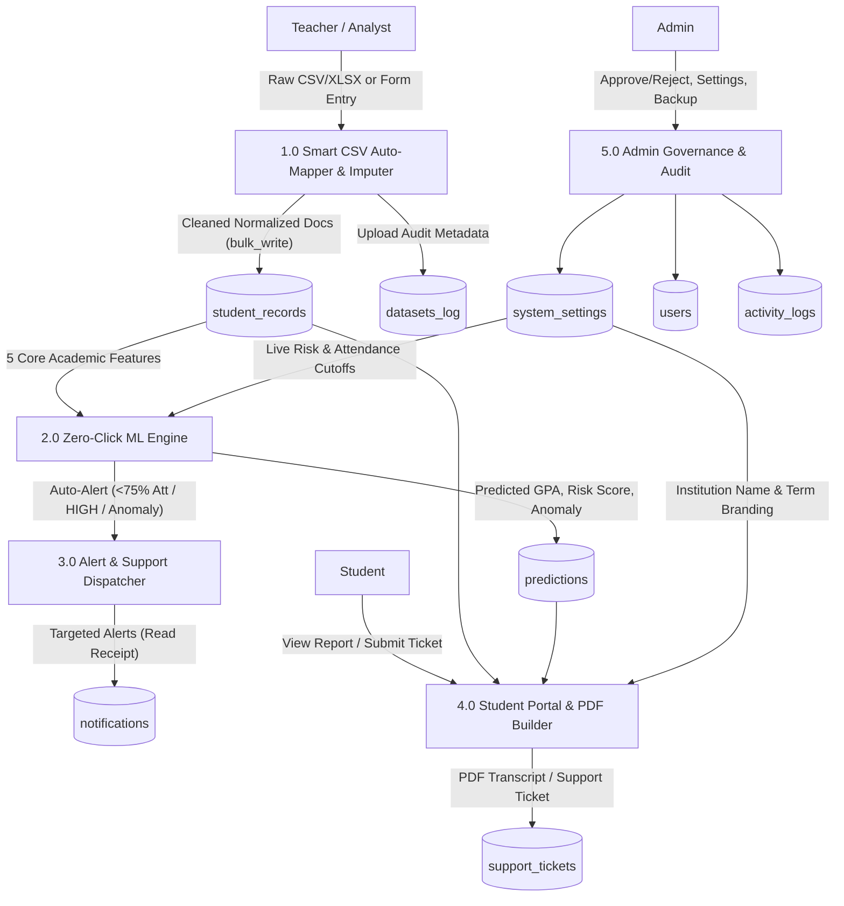

# EduPredict — Predictive Academic Analytics & Early Warning Portal

**Academic Project Submission Report (Aptech Final Evaluation)**

---

## 1. Abstract

Educational institutions generate vast amounts of student engagement, attendance, and assessment data every term, yet struggling learners are frequently identified only after midterm failures or course withdrawals occur. **EduPredict** is an enterprise-grade, predictive academic analytics and early warning portal engineered on **Python 3.12**, **Django (MVT)**, **MongoDB Atlas**, **Scikit-Learn**, **Tailwind CSS**, **ReportLab**, and **Cloudinary**.

EduPredict bridges raw institutional spreadsheets and real-time classroom telemetry with zero-click Machine Learning automation. Whenever a Teacher submits student marks or an Analyst ingests an institutional CSV/Excel file, EduPredict automatically maps non-standard column headers, imputes missing values without data leakage, trains and applies three complementary ML pipelines (**Random Forest Classifier** for dropout risk, **Ridge Regressor** for GPA forecasting, and **Isolation Forest** for sudden-drop anomaly detection), and immediately dispatches targeted intervention alerts to both Students and Faculty. Four strictly isolated role portals (**Administrator**, **Teacher**, **Student**, and **Data Analyst**) provide tailored workflows including a Student 360° diagnostic drawer, live LMS stream simulation, ReportLab official PDF transcripts with dynamic institutional branding, and production-hardened operations telemetry.

---

## 2. System Architecture Diagram



```text
[ Browser: HTML5 + Tailwind + Chart.js + Cropper.js + Vanilla JS ]
                          | (HTTP/HTTPS + CSRF + SPA Fetch)
                          v
[ Django MVT Server: SecurityMiddleware -> WhiteNoise -> RBAC Decorators ]
      |                        |                          |
      v                        v                          v
[ Accounts & Panels ]   [ Analytics & ML Engine ]   [ Core & Media ]
  - Admin Governance      - Smart CSV Auto-Mapper     - MongoDB Atlas Pool
  - Teacher Ingestion     - Median/Mode Imputation    - Short-TTL Cache
  - Student Portal        - RandomForest (n_jobs=-1)  - Cloudinary 320x320
  - ReportLab PDF         - Ridge + IsolationForest   - Fernet Backups
```

---

## 3. Technology Stack

| Layer | Technology | Version / Configuration | Purpose |
| :--- | :--- | :--- | :--- |
| **Backend Framework** | Python & Django (MVT) | Django `6.1.3` | Routing, views, templates, CSRF, PBKDF2 auth, session management |
| **Primary Database** | MongoDB Atlas (`pymongo`) | `pymongo 4.20.0` | Cloud document store across 9 indexed collections + pooling |
| **Data Processing** | `pandas`, `numpy`, `openpyxl` | `pandas 3.1.1`, `numpy 2.5.5`, `openpyxl 3.1.5` | Chunked `.csv`/`.xlsx` ingestion, imputation, aggregation |
| **Machine Learning** | `scikit-learn` | `scikit-learn 1.9.1` | `RandomForestClassifier(n_estimators=50, n_jobs=-1)`, `Ridge`, `IsolationForest` |
| **PDF Reporting** | `reportlab` | `reportlab 5.1.0` | Dynamic institutional Student Transcripts & Teacher Class Rosters |
| **Media & Cropping** | `cloudinary`, `pillow`, `Cropper.js` | `cloudinary 1.47.0`, `pillow 13.0.0`, `1.6.2` | 1:1 circular avatar & `Ctrl+V` ticket screenshot upload/cleanup |
| **Frontend & Charts** | Tailwind CSS, Chart.js, FontAwesome | Chart.js `4.4.3`, FA `6.5.2` | Light/OLED Dark theme tokens, 6 Chart.js defaults, 5-row pagination |
| **Ops & Security** | `gunicorn`, `whitenoise`, `cryptography`, `sentry-sdk` | `27.0.1`, `6.12.0`, `50.0.2`, `2.75.0` | Static compression, Fernet encrypted backups, telemetry |

---

## 4. Data Flow Diagrams (DFD Levels 0 & 1)

### DFD Level 0 (Context Diagram)



### DFD Level 1 (Core Processing & Storage)



---

## 5. Role Capabilities Matrix

| Role | Primary Route | Key Capabilities |
| :--- | :--- | :--- |
| **Administrator** | `/admin-panel/` | System overview KPIs & charts; User CRUD + Teacher Pending Approval & **Reject with Reason** (`REJECT_USER`); Course capacity tracking; Support Ticket Detail Drawer & Image Lightbox + Reply CRUD; Filterable Activity Logs + CSV export; Portal Settings (Institution Name, Term, ML thresholds, Admin-only Theme Live Studio); JSON/CSV Backups. |
| **Teacher** | `/teacher-panel/` | Class Home KPIs & watchlist; `[Table \| Cards]` Student Directory with 1-click Copy ID & **Student 360° Slide-Over Drawer** (SVG attendance ring, AI risk reasons, course breakdown); Quick Marks Entry + 3-column CSV/XLSX upload with **Smart CSV Auto-Mapper** 3-row preview; **1-Click Notify All High-Risk Students**; **Auto-Alert `< 75%` On/Off toggle**; Read `✓✓` receipt tracking; Class Roster PDF export. |
| **Student** | `/student-panel/` | Personal Dashboard (Attendance SVG ring, Predicted GPA, Class Rank, Earned Credits, Marks vs. Class Avg chart); Official Report Card with dynamic Portal/Term branding & **ReportLab PDF Transcript** download; Interactive AI Study Tips; Real-time Alerts (`visibilitychange` instant refresh) & Support Ticket submission with `Ctrl+V` clipboard screenshot cropping. |
| **Data Analyst** | `/analyst-panel/` | Big Data & ML Hub with filterable predictions explorer, CSV export, and Dataset Upload modal (with Smart CSV Auto-Mapper preview); **Simulate Live LMS Stream** 5-second polling toggle (`POST /analyst-panel/stream-tick/`); Leakage-free Model Evaluation (Confusion Matrix, Precision/Recall/F1, MAE/MSE/RMSE/R²); Model Health & threshold diagnostics. |

All authenticated roles also share **My Profile & Settings** (`/profile/`) featuring Cloudinary 1:1 circular avatar cropping with old-asset cleanup and a modalized **Change Password** flow.

---

## 6. Machine Learning & Hyper-Automation Engine

1. **Smart CSV Column Auto-Mapper (`analytics/data_pipeline.py` & `static/js/ui_widgets.js`):** Automatically normalizes institutional headers (`Roll_No`, `Enrollment`, `Reg_No` -> `student_id`; `Att_%`, `Attendance`, `Att` -> `attendance_pct`; `Test_Score`, `Exam_Score`, `Marks` -> `internal_marks`; `Prev_GPA`, `CGPA` -> `previous_gpa`; `LMS_Hours` -> `lms_hours_weekly`) with an instant client-side 4 KB preview before upload.
2. **Leakage-Free Preprocessing (`analytics/preprocessing.py`):** `MedianFallbackImputer` fits feature medians strictly on training splits during evaluation and clips values to valid bounds (`attendance_pct` 0–100, `internal_marks` 0–100, `lms_hours_weekly` 0–168, `previous_gpa` 0–4.0).
3. **Multi-Model Suite (`analytics/ml_engine.py`):**
   - **Dropout Classifier:** `RandomForestClassifier(n_estimators=50, n_jobs=-1, max_depth=4, min_samples_leaf=2)` classifying risk into `LOW`, `MEDIUM`, and `HIGH` using dynamic Portal Settings cutoffs.
   - **GPA Forecaster:** `StandardScaler` + `Ridge(alpha=1.0)` predicting next-term GPA (`0.0–4.0`).
   - **Anomaly Detector:** `IsolationForest(contamination=0.12)` paired with deterministic thresholds (attendance `< 60%`, marks `< 45%`, or `> 25%` sudden drop vs. previous GPA).
4. **Zero-Click Auto-Alert Escalation:** Every prediction run automatically upserts deduplicated alerts whenever `risk_level == "HIGH"`, `is_anomaly == True`, or `attendance_pct < min_attendance_pct` (`< 75%` default).

---

## 7. Security & RBAC Architecture

- **Strict Role Isolation:** `@role_required` and `@login_required_custom` decorators enforce view-level access control across all endpoints; unauthorized role requests redirect safely with toast feedback or HTTP 403/405 JSON responses.
- **Faculty Onboarding Guard:** Self-registered `TEACHER` accounts initialize as `approval_status="PENDING"` and `is_active=False`, blocking sign-in until an Admin approves or rejects them with an audited reason (`REJECT_USER`). Public `ADMIN` self-registration is blocked.
- **Self-Protection & Privilege Guards:** Administrators cannot delete, deactivate, reject, or downgrade their own active account (enforced on both `user_id` and `email`), nor submit support tickets to themselves.
- **Web Hardening (`config/settings.py`, `core/middleware.py`):** Django PBKDF2 password hashing, CSRF protection on forms and AJAX `POST` calls, `HttpOnly` & `SameSite=Lax` cookies, Content Security Policy (`SECURE_CONTENT_SECURITY_POLICY`), `X-Frame-Options: DENY`, HSTS in production, per-worker rate limiting headers (`X-RateLimit-Limit`, `X-RateLimit-Remaining`, `Retry-After`), and Fernet-encrypted + SHA-256 verified backups (`export_backup`, `verify_backup`, `decrypt_backup`).

---

## 8. Big Data Performance & Scalability

- **Chunked & Batched Ingestion:** Large `.csv` uploads stream in `chunksize=2000` batches (up to 25 MB) and write to MongoDB Atlas in 500-operation `bulk_write(..., ordered=False)` batches.
- **Indexed Cloud Collections:** `core/db.py` (`ensure_indexes()`) maintains indexes on `users.email` (unique sparse), `users.user_id`, `student_records.student_id`, `student_records.batch`, `student_records.updated_at`, `predictions.student_id`, `notifications.*`, and `courses.course_code`.
- **Multi-Core ML & TTL Caching:** `RandomForestClassifier(..., n_jobs=-1)` leverages all CPU cores; process-once seed locks eliminate per-request DB overhead; short-TTL in-memory caching (`get_cached` / `invalidate_cache`) keeps dashboard responses sub-second; SPA page caching (`static/js/nav.js`) and `/health/` cgroup telemetry ensure smooth production operation.
